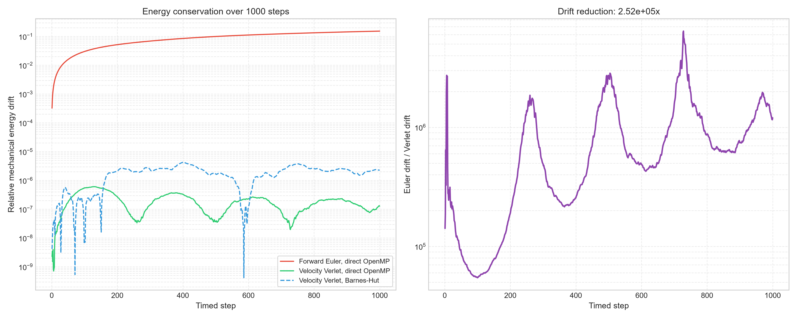
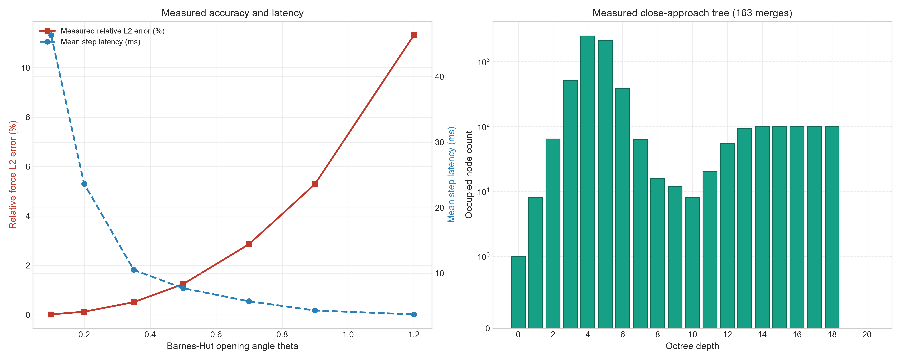
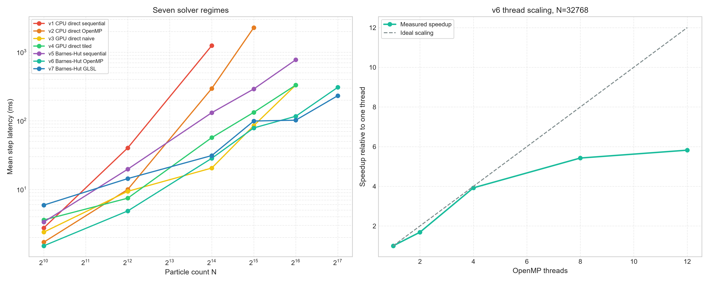

# Octree-Transport-HPC

Octree-Transport-HPC is a C++20 simulation and benchmark engine for gravitational N-body phase-space transport and stellar/cluster orbital dynamics. It evaluates seven CPU and GPU force solvers—from exact all-pairs summation to multipole Barnes-Hut spatial octrees with stackless skip-rope traversal—integrated via symplectic kick-drift-kick Velocity Verlet and Forward Euler integrators. The Barnes-Hut path builds an $O(N \log N)$ tree and follows rope links during force evaluation, while GLSL compute shaders cover the GPU direct and tree solvers.

## Implemented solvers

| Version | Solver | Method |
|---|---|---|
| v1 | CPU direct sequential | Exact $O(N^2)$ force summation |
| v2 | CPU direct OpenMP | Exact $O(N^2)$ force summation with OpenMP |
| v3 | GPU direct GLSL | Exact $O(N^2)$ compute shader |
| v4 | GPU tiled GLSL | Exact $O(N^2)$ compute shader with workgroup tiling |
| v5 | CPU Barnes-Hut sequential | Sequential octree build and traversal |
| v6 | CPU Barnes-Hut OpenMP | Parallel octant build and force evaluation |
| v7 | GPU Barnes-Hut GLSL | OpenMP host build with GPU force evaluation |

The CPU Barnes-Hut paths use stackless skip-rope traversal. Nodes store `first_child_idx` and `next_node_idx`, so accepted cells jump past their descendants without a recursion stack.

## Engineering details

- The v6 and v7 tree builders partition particles by static OpenMP ranges. Threads count octant membership, a deterministic prefix sum assigns disjoint output slices, and threads scatter particle indices without a critical section. Each root octant builds in a private growable node buffer.
- After construction, the eight subtrees are compacted into a contiguous arena. Unused reservation space is discarded, child and rope indices are remapped, and `node_count()` reports the number of constructed arena entries uploaded to v7. Empty child cells remain in the arena because each internal node addresses its eight children by `first_child_idx + octant`. The depth histogram counts occupied nodes with positive mass.
- Subdivision stops at `MAX_OCTREE_DEPTH = 20` or `MIN_CELL_HALF_EXTENT = 1e-5`. Coincident and very close particles descend to a bounded local leaf and are represented by their combined mass and center of mass. The `coincident_merges` field counts particle insertions absorbed by aggregated leaves.
- Velocity Verlet uses kick-drift-kick integration. The benchmark records energy, linear momentum, and angular momentum drift and compares it with Forward Euler.
- The theta sweep computes exact direct accelerations and Barnes-Hut accelerations for the same initial particle state. Relative $L_2$ error is computed from the full acceleration vectors; force speedup compares the direct force time with the Barnes-Hut force time.

## GPU Barnes-Hut path

`GPU_BarnesHut_GLSL (v7)` builds the octree on the host with OpenMP, compacts the node arena, and uploads exactly `node_count()` entries to an OpenGL Shader Storage Buffer Object. The executable creates a hidden GLFW window when running headlessly (`GLFW_VISIBLE = GLFW_FALSE`), requests an OpenGL 4.6 core context, and falls back to 4.3. `octree_bh_v7.comp` evaluates the Barnes-Hut acceleration on the GPU. Velocity Verlet integration and particle state updates remain on the host. The shader sources use GLSL 4.30 so they work with the 4.3 fallback.

## Measured results

The checked-in JSON and figures are generated by `scripts/run_benchmarks_and_plots.py`. The tables below reproduce values from [`assets/benchmark_results.json`](assets/benchmark_results.json). Timing values are milliseconds. Floating-point values are shown as stored in that JSON.

### Run environment

| Field | Measured value |
|---|---|
| Platform | `Windows-11-10.0.26200-SP0` |
| CPU architecture | `AMD64` |
| Python processor string | `Intel64 Family 6 Model 154 Stepping 3, GenuineIntel` |
| OpenMP maximum threads | `12` |
| OpenGL renderer | `Intel(R) UHD Graphics | Intel | GL 4.6.0 - Build 32.0.101.7076` |
| Measurement timestamp (UTC) | `2026-11-03T21:23:46Z` |

### Seven-regime scaling at $N=4096$

Each row uses 10 timed steps. The executable also performs one untimed warmup step before timing.

| Solver | Mean step (ms) | Mean tree build (ms) | Mean force evaluation (ms) |
|---|---:|---:|---:|
| v1 CPU direct sequential | 40.25451999999999 | 0 | 39.97267 |
| v2 CPU direct OpenMP | 9.97217 | 0 | 9.70809 |
| v3 GPU direct GLSL | 9.368310000000001 | 0 | 9.150380000000002 |
| v4 GPU tiled GLSL | 7.445530000000001 | 0 | 7.07561 |
| v5 Barnes-Hut sequential | 19.70019 | 0.49063999999999997 | 18.89772 |
| v6 Barnes-Hut OpenMP | 4.84891 | 1.4397499999999999 | 3.09687 |
| v7 Barnes-Hut GLSL | 14.366819999999999 | 1.2158799999999998 | 12.79307 |

The complete particle-count matrix is in the JSON file and Figure 1.

### v6 OpenMP thread scaling at $N=32768$

| Threads | Mean step (ms) | Speedup |
|---:|---:|---:|
| 1 | 376.32076 | 1 |
| 2 | 223.18430000000004 | 1.6861435145751738 |
| 4 | 95.91866000000002 | 3.923332123280287 |
| 8 | 69.35381 | 5.426100743419864 |
| 12 | 64.63405 | 5.822329871019996 |

### Barnes-Hut theta sweep at $N=4096$

`relative_l2_force_error` and `speedup_vs_direct` are measured by the executable. Speedup is a force-evaluation comparison, not a whole-step comparison.

| $θ$ | Mean step (ms) | Relative $L_2$ force error | Speedup vs. direct force |
|---:|---:|---:|---:|
| 0.1 | 46.319599999999994 | 0.00019288017509545467 | 0.4554516989982785 |
| 0.2 | 23.64902 | 0.001271596519937647 | 0.908288503873394 |
| 0.35 | 10.51402 | 0.005134169766543134 | 2.925818068939029 |
| 0.5 | 7.7104 | 0.012422225689069477 | 3.9235400435758616 |
| 0.7 | 5.717280000000001 | 0.02857830799032645 | 7.209157799683433 |
| 0.9 | 4.31312 | 0.0529527641463448 | 10.511297821153214 |
| 1.2 | 3.72241 | 0.11312536714775938 | 15.436306747399831 |

### Trajectory conservation

The runs use 1,024 particles, 1,000 timed steps, and $dt = 0.002$. Energy is evaluated at every timed step for these runs. Momentum drift columns are absolute vector-norm differences from the initial momentum.

| Integrator and solver | Initial energy | Final energy | Maximum energy drift | Maximum linear momentum drift | Maximum angular momentum drift |
|---|---:|---:|---:|---:|---:|
| Forward Euler, direct OpenMP | -25.40683221871809 | -21.507833898492176 | 0.15346259174149965 | 2.473193950697229e-07 | 0.7393335938773132 |
| Velocity Verlet, direct OpenMP | -25.406832218718044 | -25.40682896896203 | 6.085114572111812e-07 | 1.1378601654116762e-06 | 6.251986213356041e-07 |
| Velocity Verlet, Barnes-Hut OpenMP | n/a | n/a | 4.304772078373448e-06 | 0.016795013623213225 | 4.496191196976829e-05 |

For the direct solver runs, the measured maximum energy-drift reduction from Forward Euler to Velocity Verlet is `252193.43025161995`.



For runs above 16,384 particles, `max_energy_drift` samples the first and final timed steps to avoid an $O(N^2)$ energy calculation at every step. The JSON metadata states this sampling policy.

### Close-approach stress configuration

Initializer 8 creates 50 exact coincident pairs, 50 pairs separated by $10^{-9}$, and a 64-particle dense core. This measurement uses 4,096 particles, one timed step, and $dt = 0$ to keep the injected positions unchanged while the tree is measured.

| Metric | Measured value |
|---|---:|
| Maximum depth | 18 |
| Constructed arena nodes | 19209 |
| Coincident merges | 163 |
| Occupied nodes by depth, $d=0..20$ | `[1, 8, 64, 512, 2495, 2097, 385, 63, 16, 12, 8, 20, 55, 94, 100, 101, 101, 101, 101, 0, 0]` |

The histogram is the exact `octree_depth_histogram` array from the same C++ run stored in the JSON and used for Figure 3.





## Build and test

### Linux (Ubuntu / Debian)

Install the C++ compiler, CMake, Ninja, OpenMP, OpenGL, GLEW, GLFW, GLM, GoogleTest, and Xvfb. On Ubuntu:

```bash
sudo apt-get update
sudo apt-get install -y build-essential cmake ninja-build libgl1-mesa-dev libglew-dev libglfw3-dev libglm-dev libgtest-dev xvfb
cmake -S . -B build -G Ninja -DCMAKE_BUILD_TYPE=Release
cmake --build build --parallel
LIBGL_ALWAYS_SOFTWARE=1 xvfb-run -a ctest --test-dir build --output-on-failure
```

On headless HPC cluster nodes or enterprise Linux environments, ensure the required development packages are loaded (e.g. via environment modules) and run under Xvfb for GLFW context tests.

### Windows with MSYS2 UCRT64

Open an MSYS2 UCRT64 shell and install the dependencies:

```bash
pacman -S --needed mingw-w64-ucrt-x86_64-gcc mingw-w64-ucrt-x86_64-cmake mingw-w64-ucrt-x86_64-ninja mingw-w64-ucrt-x86_64-glfw mingw-w64-ucrt-x86_64-glew mingw-w64-ucrt-x86_64-glm mingw-w64-ucrt-x86_64-gtest
cmake -S . -B build -G Ninja -DCMAKE_BUILD_TYPE=Release
cmake --build build --parallel
ctest --test-dir build --output-on-failure
```

The GPU-dependent tests skip when GLFW cannot create an OpenGL context. Shader compilation and compute errors still fail the test when a context is available.

## Run benchmarks

Install Python 3, NumPy, and Matplotlib in a virtual environment, then run:

```bash
python -m venv .venv
source .venv/bin/activate
python -m pip install numpy matplotlib
python scripts/run_benchmarks_and_plots.py
```

In PowerShell, activate with `.venv\Scripts\Activate.ps1` and run `python scripts\run_benchmarks_and_plots.py`. The script refreshes [`assets/benchmark_results.json`](assets/benchmark_results.json) and the three PNG figures.

## Command-line use

```text
octree_transport_hpc [options]
  -v, --version <1..7>       Select a solver regime
  -i, --init <1..8>          Select an initializer
  -f, --file <path>          Load particle data from a text file
  -n, --num-particles <N>    Set particle count
  -t, --dt <float>           Set the integration time step
  -s, --softening <float>    Set gravitational softening
  --theta <float>            Set Barnes-Hut opening angle
  --integrator <euler|verlet>
  --headless                 Use a hidden GLFW context for GPU runs
  --steps <count>            Set the number of timed steps
  --compare-direct           Measure force error and speedup against exact direct forces
  --reset-after-warmup       Restore the initial particle state after warmup
  --json-out <path>          Write JSON telemetry
```

Example measured theta point:

```bash
./build/octree_transport_hpc -v 6 -i 2 -n 4096 --theta 0.5 --headless --steps 10 --compare-direct --reset-after-warmup --json-out theta.json
```

## License

This project is released under the MIT License. See [LICENSE](LICENSE).

## References & Acknowledgments

The tree approximation follows J. Barnes and P. Hut, [“A hierarchical $O(N \log N)$ force-calculation algorithm”](https://doi.org/10.1038/324446a0), *Nature* 324 (1986), 446–449. The tiled direct-force comparison was informed by L. Nyland, M. Harris, and J. Prins, [“Fast N-Body Simulation with CUDA”](https://developer.nvidia.com/gpugems/gpugems3/part-v-physics-simulation/chapter-31-fast-n-body-simulation-cuda), *GPU Gems 3*, Chapter 31 (2007).
